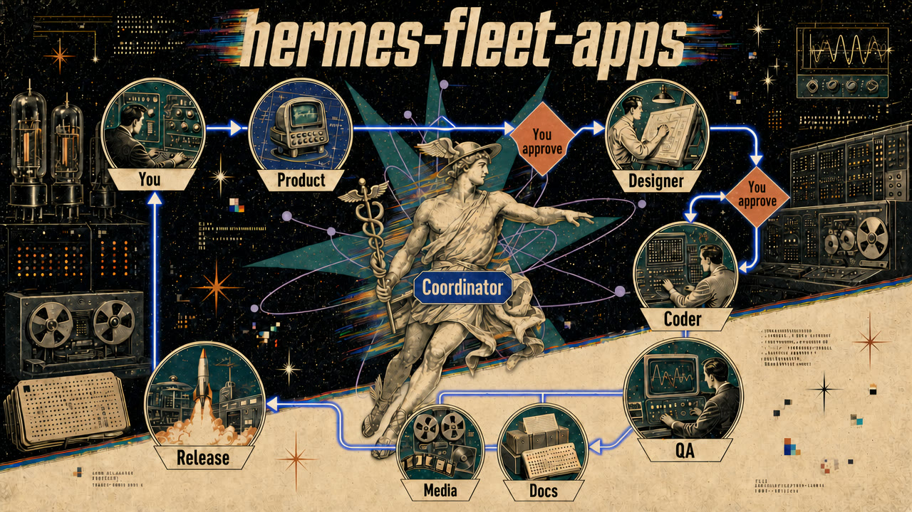

# hermes-fleet-apps



*High-level picture only. The exact roles and rules are below.*

A Hermes agent fleet for building local apps and tools: desktop apps, CLIs and small local
web UIs, Python first, from idea to installer and release. Made for one person driving it.

The fleet is seven roles. Each role is a `SOUL.md` (who the agent is and how it works) plus
its skills. You copy them into your own profiles of
[Hermes Agent](https://github.com/NousResearch/hermes-agent).

## Tested on / Not tested yet

- **Tested on:** desktop apps, command-line tools (CLIs) and small local web UIs, written
  in Python, taken by one person from idea to installer and release, on Windows.
- **Not tested yet:** macOS and Linux; online services with servers, accounts or payments;
  mobile apps; stacks other than Python. The roles may work there, but nobody has checked.

## How the work flows

```
idea
 -> product      writes the spec
 -> [gate: you approve the spec]
 -> designer     writes the visual plan
 -> [gate: you approve the design]
 -> coder        builds it, with tests
 -> qa           checks it, independently
 -> media + docs videos, README, release notes
 -> release

coordinator: routes every step to the right role and checks what comes back
```

## The roles

| Role | What it does | What it hands to the next | Folder |
|---|---|---|---|
| coordinator | Your daily agent. Turns ideas into jobs, routes them, merges, checks, reports to you. Builds nothing itself. | A brief per job; a short report to you per stage | `roles/coordinator/` |
| product | Turns an idea into a spec: who it is for, what is in v1, what "done" means. | `SPEC.md` and tickets | `roles/product/` |
| designer | Turns the spec into a visual plan: brand, screens, logo, colours, fonts. | `.design/` (brand, UI plan, `tokens.json`, logo, image briefs, research) | `roles/designer/` |
| coder | Senior engineer: architecture, code, tests, CI, git. | Code, tests, a CHANGELOG entry | `roles/coder/` |
| qa | Independent check: runs the build, reviews code and security, reproduces bugs. Never edits code. | `QA-REPORT.md` (pass/fail and a punch-list) | `roles/qa/` |
| media | Demo GIFs and videos, rendered from code with the design's colours and fonts. | `assets/` (gif, mp4) | `roles/media/` |
| docs | Release text: README, changelog, release notes, store listings. | README, store listing, release notes | `roles/docs/` |

Who leaves what for whom, in detail: [docs/handoff-rules.md](docs/handoff-rules.md).

## Two gates only

You decide twice per project:

1. the spec, after product;
2. the design, after designer.

The rest runs on its own. Coder, qa, media and docs work without asking you, and the
coordinator reports when a stage is done or truly blocked. Two things always wait for you
anyway: anything that makes something public (push, tag, post), and any credential.

## Lessons that shaped it

- **The builder never grades its own work.** qa runs the build itself and never edits code,
  not even a typo. It writes a punch-list; the coder fixes.
- **Merge only on green tests.** The merge commit happens only if the test suite passes; a
  red run aborts the merge.
- **Workers never create cards.** Only the coordinator plans. A worker writes follow-ups into
  its report, and the coordinator decides what happens next.
- **Handoff after two compressions.** When a job's context has been compressed twice, the
  agent writes a handoff and stops. A fresh session continues from the files, not from a
  blurred conversation.
- **Project state lives in the repo.** Never in an agent's memory. The fleet map says who
  does what; the repo says where the project stands.
- **Clean up after every job.** Scratch files, test output, servers left running. Every agent
  says what it removed.
- **Secrets never pass through the chat.** No agent reads, copies or prints a key. It tells
  you which file and variable to fill in, and you type it.

## How to use it

Step by step: [docs/adopt.md](docs/adopt.md). Short version: one Hermes profile per role,
copy in its `SOUL.md` and `skills/`, start with coordinator and coder, add qa next.

## Third-party skills

The roles also use skills that other people wrote. They are not copied here: install them
from their source. The list, with install ids and credit:
[docs/third-party-skills.md](docs/third-party-skills.md).

A few skills in this repo are adapted from MIT-licensed skills by other authors. Each one
names its source and copyright in its own `SKILL.md`.

## Ideas from the community

Ideas from readers are welcome. Each one is tried in the real fleet first, and lands here
only if it helps.

## Licence

MIT. See [LICENSE](LICENSE).
